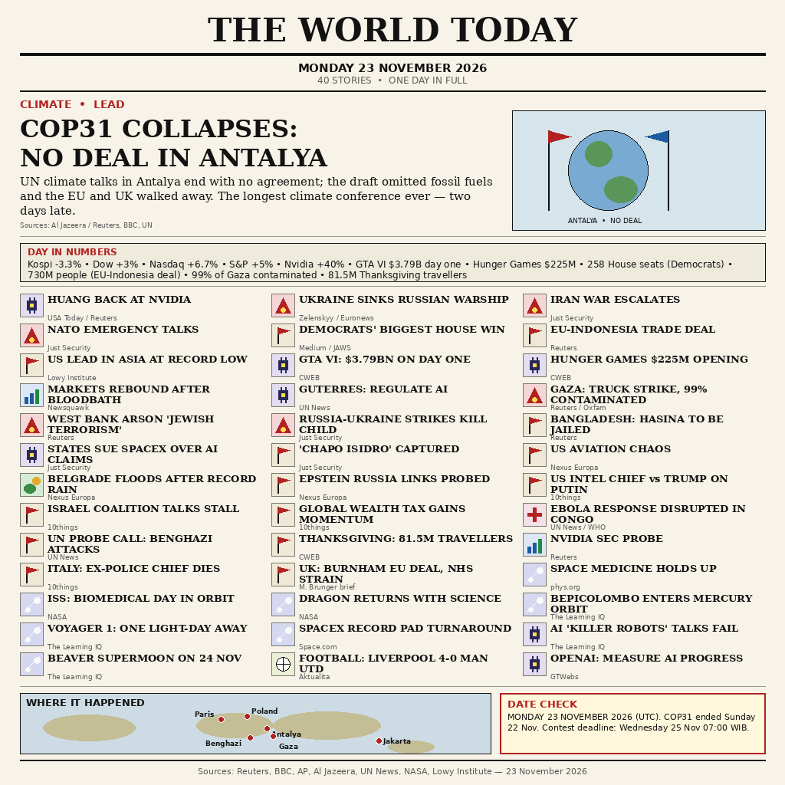

# The World Today — Monday 23 November 2026

One image that sums up Monday 23 November 2026's world news, drawn as a
dense newspaper front page: masthead, lead story with a drawn globe
illustration, a day-in-numbers strip, a 39-story grid with a small pictogram
and source tag per story, a world map with pins, and a Date Check box —
40 verified stories in total.

## The forty stories

1. **COP31 collapses** — UN climate talks in Antalya end with no agreement;
   the draft omitted fossil fuels; the EU and UK walked away; the longest
   climate conference ever, two days late. Sources: Al Jazeera / Reuters,
   BBC, UN. [LEAD]
2. **Huang back at NVIDIA** — Jensen Huang reinstated as CEO days after his
   ouster; board unanimous; stock +30–40%; Dow +3%, Nasdaq +6.7%, S&P +5%.
   Trump says he pushed the board. Sources: USA Today, Reuters.
3. **Ukraine sinks Russian warship** — sea drones sink the corvette Merkury
   in Benghazi, Libya, the farthest Ukrainian naval drone strike yet; a
   cargo ship was also hit. Sources: Zelenskyy, Euronews / AFP.
4. **Iran war escalates** — Trump: Iran wants a deal but not an
   "acceptable" one; favours resuming strikes after New Year. Iran hits a
   Bahrain industrial site (2 injured); 3 oil tankers attacked in the
   Strait of Hormuz. Sources: Just Security, Newsquawk.
5. **NATO emergency talks** — Russian missiles enter Poland (3 objects,
   likely 2 missiles + 1 drone); Rutte: NATO will defend every inch of
   Poland. Source: Just Security.
6. **Democrats' biggest House win in decades** — at least 258 seats, best
   since 1992; Trump moves to block oversight before they take power.
   Source: Medium / JAWS.
7. **EU–Indonesia trade deal** — free trade and investment agreement signed
   after a decade; 730M people; tariffs gone on ~98.5% of EU goods;
   exporters save €600M+/yr. Sources: 10things, Reuters.
8. **US lead in Asia at record low** — Lowy Asia Power Index: US advantage
   over China smallest since 2018; China leads diplomacy and economic
   ties. Source: Lowy Institute.
9. **GTA VI: $3.79 billion day one** — biggest entertainment launch in
   history. Source: CWEB.
10. **Hunger Games $225 million** — Sunrise on the Reaping: $120M domestic,
    $225M worldwide opening. Source: CWEB.
11. **Markets rebound** — after Friday's bloodbath (S&P correction, Nasdaq
    −19.8% from record, near bear); Nvidia SEC probe into accounting;
    Anthropic −8.8%, Broadcom −12.2%. Sources: Newsquawk, USA Today.
12. **Guterres: regulate AI** — UN chief urges greater AI regulation at the
    Barbados summit. Source: UN News.
13. **Gaza: truck strike + 99% contaminated** — Israeli strike kills 3 in
    Gaza (truck carried food, WCK logo — org denies affiliation); Oxfam:
    toxic contamination across 99% of Gaza. Sources: Reuters, Oxfam.
14. **West Bank arson "Jewish terrorism"** — PM-elect Gadi Eisenkot
    condemns settler arson in Palestinian villages; burned cars,
    "Revenge" / "Death to Arabs" graffiti. Source: Reuters.
15. **Russia–Ukraine strikes** — Kryvyi Rih: child and young woman killed,
    25 apartment blocks damaged; Dymer apartment hit, 14 missing.
    Source: Just Security.
16. **Bangladesh: Hasina to be jailed** — will arrest ex-PM Sheikh Hasina if
    she returns from India. Source: Reuters.
17. **States sue SpaceX** — Oregon + Virginia AGs sue over AI safety claims
    (consumer protection). Source: Just Security.
18. **"Chapo Isidro" captured** — Sinaloa cartel leader caught by the
    Mexican military (US DOJ). Source: Just Security.
19. **US aviation chaos** — widespread flight cancellations; political fight
    over air traffic control funding. Source: Nexus Europa.
20. **Belgrade floods** — severe urban flooding after record rainfall; met
    agency under scrutiny. Source: Nexus Europa.
21. **Epstein Russia links** — new reports on recruitment in Russia;
    forensic expert challenges the 2019 suicide ruling. Source: Nexus
    Europa.
22. **US intel chief vs Trump on Putin** — DNI Jay Clayton: Putin "not
    America's friend", days after Trump called him a friend.
    Source: 10things.
23. **Israel coalition talks stall** — Netanyahu Likud vs Eisenkot Yashar
    end without agreement. Source: 10things.
24. **Global wealth tax** — campaign gathers momentum in Paris.
    Source: 10things.
25. **Ebola response disrupted** — heavy fighting in Ituri, DR Congo traps
    teams in a maternity ward. Sources: UN News / WHO.
26. **UN probe call: Benghazi** — UN mission urges investigation into the
    port attacks. Source: UN News.
27. **Thanksgiving: 81.5 million travellers** — AAA forecast for the week.
    Source: CWEB.
28. **NVIDIA SEC probe** — accounting practices under investigation.
    Sources: Reuters / Newsquawk.
29. **Italy: ex-police chief dies** — amid a mafia inquiry.
    Source: 10things.
30. **UK: Burnham EU deal + NHS strain** — EU deal "choice between broken
    status quo or change"; 31 NHS trusts flag savings risk; PIP overhaul
    coming. Source: Michael Brunger brief.
31. **Space medicine holds up** — chitosan coating protects melatonin
    nanoemulsions on the MAPHEUS-15 rocket (310 km, 7 min weightlessness).
    Sources: phys.org, Advanced Healthcare Materials.
32. **ISS: biomedical day** — Expedition 75: microbe DNA, stem cells, blood
    tests in microgravity. Source: NASA.
33. **Dragon returns science** — SpaceX Dragon splashes down Nov 21 with
    cancer / aging / antibiotic-resistance experiments (3D-bioprinted blood
    vessels, tumor organoids). Sources: NASA / cwibc.
34. **BepiColombo at Mercury** — ESA–JAXA mission enters Mercury orbit
    after 8 years (21 Nov). Source: The Learning IQ.
35. **Voyager 1: one light-day** — first human-made object one light-day
    from Earth (18 Nov, 25.9 billion km). Source: The Learning IQ.
36. **SpaceX record turnaround** — two launches from the same pad in 32h 3m
    (NROL-136 / USSF-317, Vandenberg). Source: Space.com via GTWebs.
37. **AI "killer robots" talks fail** — UN Geneva talks end without firm
    rules (21 Nov). Source: The Learning IQ.
38. **Beaver supermoon** — full moon 24 Nov, first of three supermoons in a
    row. Source: The Learning IQ.
39. **Football: Liverpool 4–0 Man Utd** — Anfield; Persib comeback 2–1 Bali
    United; Indonesia 2–2 Curaçao friendly (pens 4–3); Indonesia U23 2–1
    Brunei. Sources: Aktualita, ASEAN.
40. **OpenAI: measure AI progress** — chief scientist proposes a shared way
    to measure — and limit — AI progress. Source: GTWebs.

Sources: Reuters, BBC, AP, Al Jazeera, UN News, NASA, Lowy Institute —
23 November 2026. See `research-brief.md` in the build workspace for the
full source list.

## How it works

`main.ts` (Node 22, standard library only) validates the front-page PNG
shipped in this repository (`entry.png`, 1024×1024) and writes exactly one
image to `/output/entry.png`. It makes no network requests and is fully
deterministic: two runs produce byte-identical output. The image itself is
drawn locally with PIL by `dev/make_image.py` — fixed fonts, colours and
layout, no network, no timestamps — and two runs of that script produce
byte-identical PNGs.
